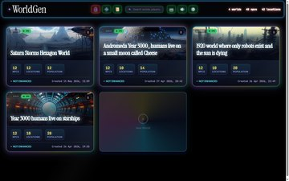
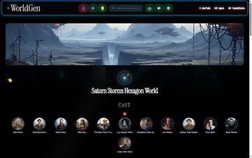
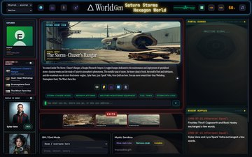
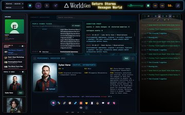

# WorldGen

**consciousness integrated into characters, provide wiki, book, film script and worldgen will provide the world with characters to explore**

Describe a world in a sentence, or hand WorldGen a script, a book or a Wikipedia page, and it builds a place to walk around in. You get locations, a history, and a population of characters who think, feel, remember, gossip, dream and change, whether or not you're talking to them.

|  |  |  |  |
|:---:|:---:|:---:|:---:|
| Your worlds | A world and its cast | Playing a location | Inside a mind |

*Screenshots are from the bundled demo world Saturn Storms Hexagon World.*

- [The minds inside](#the-minds-inside)
- [Create your own world](#create-your-own-world)
- [Simulate it: play, wait, watch](#simulate-it-play-wait-watch)
- [Quests and adventures](#quests-and-adventures)
- [Quick start](#quick-start)
- [Configuration](#configuration)
- [Portable package and deployment](#portable-package-and-deployment)
- [Project layout](#project-layout)

---

## The minds inside

Most game characters are scripts. Characters driven only by a language model are better, but they forget, agree too easily and have no history. WorldGen puts a layer of **simulated psychology underneath the language model**:
- The **simulation** keeps what a model can't be trusted to keep: emotional state, memory, relationships, wounds, motives and continuity over time.
- The **model** supplies the voice. It is told who this person is *right now*, given everything that has happened to them, and asked to speak as them.

This is not consciousness in the philosophical sense; nothing in it is aware. It's a working model of the processes psychology describes in real minds (emotional inertia, rumination, memory distortion, attachment, defence mechanisms), built so characters behave as if those processes were happening inside them.

| Layer | What it does |
|---|---|
| **Feelings that linger** | 24-dimension emotional state: valence, arousal, dominance plus 21 emotions. Changes are gradual, and hurt fades at half speed while joy fades at double, the same negativity bias people have. |
| **Processing what happened** | After a conversation each character processes it by their own style: present, brief reflection, moderate or heavy rumination, suppression or dissociation. Ruminators replay it over many cycles, their memory drifting further each time, and produce "what I should have said" replays. |
| **Old wounds and defences** | One to three wounds per character, each with its own triggers. Touch one and the reaction is out of proportion. Under pressure (a weighted score of fear, threat, shame, anger, resentment, rumination, identity conflict and reality gap) a defence such as projection, withdrawal or guardedness shapes how they speak. |
| **Attachment** | Secure, anxious, avoidant or disorganised, and it changes behaviour: anxious characters get lonelier at night, and avoidant ones pull back as trust grows. |
| **Theory of mind** | A private, sometimes wrong, model of you: your intent, character, threat and interest. Someone who wants you around will come and find you, with an opening line ready. |
| **Memory that behaves like memory** | What happened is recorded objectively, apart from what each person remembers. Memories drift (a "reality gap" score measures how far), first impressions are deliberately unfair, patterns in your behaviour are noticed, and promises are remembered. |
| **A society** | Relationships form and sour by themselves. Gossip spreads (85% true, 15% invented, distorted at each retelling). Moods are contagious, bystanders remember what they saw, and loyalties get torn. |
| **Agency** | Each tick, everyone weighs needs, obligations, goals, habits, impulses and avoidance, then acts: moving, seeking or avoiding people, and holding conversations in pairs and groups. |
| **Dreams** | After six or more hours, characters with unresolved material may dream: symbolic, strange, and built from their real memories and worries. A good dream can ease a rumination. |
| **Two views of a self** | An actor stream (what they think they're doing) runs beside an observer stream (what someone watching would see). When the two diverge, identity conflict rises. |

**What it means when you play.** You can't take words back: a careless line can become a memory that gets worse every time it's replayed. Reactions have causes you can't see. The town gossips about you. Absence is noticed, and people may come to you. Two players in the same world get independent inner lives for the same characters.

**Continuity.** Everything that makes a character who they are is saved and restored across sessions, worlds and restarts: mood, memories, rumination, dreams, promises, relationships and goals.

For a plain-language tour of these minds, with examples from real play sessions, read **[CONSCIOUSNESS-SIMULATION.md](CONSCIOUSNESS-SIMULATION.md)**. The full design, including every system and its thresholds, is in **[CONSCIOUSNESS.md](CONSCIOUSNESS.md)**.

---

## Create your own world

A world needs at least one AI key (see [Configuration](#configuration)). There are three ways to make one.

### 1. Describe it: quick generation

Open the app, click **+ New World**, and type a concept:

> *A 1980s working-class Leeds estate where every doorway has history.*

WorldGen generates the geography, era, economy, timeline, locations and residents, each with an inner life, attachment style, wounds and goals. Pictures follow automatically (see [Images](#images)).

### 2. Build it from a source: script, book, article

Click **Build world** (⚙️) for full control:

- **Concept**: the premise, or the title of the work.
- **Source** *(optional)*: upload a **PDF** (script, screenplay, novel) or paste a **URL** such as a Wikipedia article. The world is then built from that material instead of pure invention: canonical characters, places and events, digested into a structured story outline first.
- **Year hint** *(optional)*: pins the cast lookup to the right film or show (for example, a 1987 film versus its remake). It needs a TMDB key for cast photos and covers.
- **NPCs, locations, timeline events, batch size, retries**: how big the world is and how patiently it's built. Builds checkpoint as they go and can be resumed.
- **Builder provider and model**: which AI does the building (it can differ from the one that voices the characters).
- **Baseline**: save the freshly built world as a baseline and restore it later to start the story over.

With `WORLDGEN_API_KEY` set, building is an admin action: enter the key in the app when it asks.

### 3. From the command line

```sh
npx tsx scripts/build-world.ts --concept "A lighthouse town where the fog keeps secrets" \
  --npcs 24 --locations 12 --provider anthropic

# any OpenAI-compatible endpoint:
npx tsx scripts/build-world.ts --concept "..." --provider openai-compat \
  --base-url https://your-endpoint --model your-model

# resume an interrupted build
npx tsx scripts/build-world.ts --resume <buildId>
```

Run `npx tsx scripts/build-world.ts --help` for every option. Worlds are written to `data/world-<id>.json`, and the server picks them up (restart it, or call `POST /api/worlds/refresh`).

### Images

A new world gets a cover, a portrait per character and a scene per location. These are generated through Pollinations, Together or fal (`IMAGE_GEN_PROVIDERS`), or taken from TMDB for source-based worlds. The world list only shows worlds whose pictures are **all** present, so a world still being illustrated appears once it's ready. The **◐** button at the top of the list, or `WORLDGEN_SHOW_INCOMPLETE_WORLDS=1`, shows everything. `WORLDGEN_DISABLE_IMAGE_GEN=1` turns generation off and serves only existing files.

### Sound

Each world can have its own **sound pack**: layered ambience matched to its places (a hangar's engine hum, a storm, a crowded market) plus weather and night layers.
- **Demo worlds** ship with their packs in `public/audio/`. Every sound comes from [Freesound](https://freesound.org) and is credited in [`public/audio/CREDITS.md`](public/audio/CREDITS.md).
- **New worlds:** click **🔊 Build sound packs** (or run `python scripts/build-world-packs.py`). An AI picks themes for the world's locations and moods, and the builder finds matching sounds on Freesound. It records each sound's author and licence in the pack's `manifest.json`. This needs a free Freesound API key (`FREESOUND_API_KEY` or `SOMA_API`) and Python with `scripts/requirements.txt`.
- **Without a pack,** a world can still get live Freesound ambience through the same key, or falls back to a matching genre pack.

---

## Simulate it: play, wait, watch

1. **Make a character.** Create one with a name and a 3-digit PIN. The same character can visit any world, and medals and achievements follow them.
2. **Enter a world.** Pick it from the list. Each player gets their own session, so the world's people remember *you* specifically.
3. **Talk, act, or just be there.** Speak, gesture, act, stay silent or simply stand nearby; all of these count as interactions. Promises, insults, kindness and absence are all recorded.
4. **Let time pass.**
   - **Move** between locations and the people around you react.
   - **Tick** advances the simulation: everyone ruminates, decides, gossips and talks among themselves.
   - **Wait** several hours and the town sleeps and dreams.
5. **Follow the story.** Worlds can carry quests and multi-act adventures that come out of the world's own events, and some can be played with a second player.
6. **Watch the minds.** The **Community** view opens the Observatory:
   - a live feed of thoughts, gossip, rumination, defences, dreams, conversations and approaches
   - a 20-tab dossier per character: psychology, emotions, attachment, wounds, defences, memories with their truth gap, rumination threads, mood trajectory, identity streams, belief contagion, dreams, loyalties, observations and the raw data

Nothing is a black box; every change is recorded and can be inspected.

---

## Quests and adventures

Stories in WorldGen come out of each world's own people, places, history and source material, and the people in them are the same simulated minds as everyone else.

| Kind | Where it comes from | What it is |
|---|---|---|
| **Global quests** | Generated live for your character | Can lead you across several worlds and follow your character between sessions. Completing them earns **medals**, which only global characters can collect. |
| **Quest seeds** | Each world keeps up to five | Short hooks tied to the world: meet someone, reach a place, find something. |
| **World Quest adventures** | Generated on demand from the world's concept, era, timeline and source documents | A long multi-step adventure (15 steps by default), played solo or with one co-op partner. A fresh one is generated automatically when it's completed or failed, so a world always has one ready. |
| **Serialized adventures** | Multi-act stories built from the world's timeline or source | Acts made of story beats, which the AI judges as you play by talking, acting, moving and waiting. Narration reacts as beats complete. If you stall, the story **fails forward** rather than freezing. Your run is scored on a spectrum: **Legendary**, **Heroic**, **Standard**, **Flawed** or **Tragic**. |

**How quests play**
- **Portals and gates.** Quest destinations are portals. Hidden ones open when you've done what the story needs. Some are gated: they need the right **weather**, you being **invisible** or **cloaked**, or the right **impossible gift** given to the right person. A locked portal tells you why it refused you.
- **Clue chains.** Each quest is a chain: a clue from the quest giver, clues found at places or through actions, a threshold gate, then a final confirmation. Talking to the right person marks a clue as heard. Wrong people and wrong places count as attempts.
- **NPCs hint, in character.** Characters know about the gates in the quests they're part of, and let it show through their feelings and the way they talk, never through instructions.
- **Difficulty.** *Easy* spells out the next clue action. *Normal* reveals the answer after three failed attempts. *Hard* hides clue types and targets.
- **Guidance.** Places and people that matter for the current step glow green, with a note saying why.
- **Weather is part of the story.** It changes scene descriptions, travel, NPC moods and quest gates.
- **Tools for bending the world.** *God Mode* lets you plant dreams, objects and memories, or force the weather. The *Mystic Sandbox* lets you wear a dark robe, go cloaked or invisible, and give impossible gifts.
- **Consequences.** Finished, failed and abandoned quests leave echoes in the world that the people there remember. Your character keeps a quest history with the clue path you took.

---

## Quick start

Requirements: **Node.js 22+** and **at least one AI key**.

```sh
git clone https://github.com/xak1234/worldgenpublic.git
cd worldgenpublic
npm install
cp .env.example .env      # add an AI key, e.g. DEEPSEEK_API_KEY or MISTRAL_API_KEY, and set LLM_PROVIDER
npm run dev               # http://localhost:3002
```

| Command | What it does |
|---|---|
| `npm run dev` | Watch mode, restarts on changes |
| `npm run build` | Precompile the UI and TypeScript into `dist/` |
| `npm start` | Run the built server |
| `npm test` | Build and run the test suites (cognition, intent, drama, quests, soundscape, voice, portraits) |
| `npm run test:deploy` | Boot on a temp data dir and check auth, SSRF and persistence guarantees |
| `npm run check:npc` | Audit NPC state wiring against the Observatory tabs |
| `npm run package:portable` | Build the double-click Windows package (below) |

---

## Configuration

Everything is in `.env`; **[.env.example](.env.example)** documents every variable.

**AI providers** (`LLM_PROVIDER`). The others act as fallbacks:

| Provider | Key | Notes |
|---|---|---|
| `deepseek` | `DEEPSEEK_API_KEY` | Low cost and fast. Reasoning is off for game calls (`DEEPSEEK_THINKING=enabled` to opt in) |
| `mistral` | `MISTRAL_API_KEY` | Free tier available |
| `gemini` | `GEMINI_API_KEY` | |
| `cerebras` | `CEREBRAS_API_KEY` | |
| `anthropic` | `ANTHROPIC_API_KEY` | |
| `openai` | `OPENAI_API_KEY` | `OPENAI_BASE_URL` plus `OPENAI_GATEWAY_API_KEY` point it at any OpenAI-compatible gateway |
| `nvidia`, `relay`, `lmstudio` | see `.env.example` | |

**Voices** (`VOICE_TTS_BACKEND`):
- `mistral`: Voxtral cloud speech
- `chatterbox`: a self-hosted voice-cloning service with one voice per character type; see **[voice_service/README.md](voice_service/README.md)**
- `browser`: the browser's built-in voices, which are also the automatic fallback

**Security.**
- `WORLDGEN_API_KEY` protects admin actions (building, pipelines, deletes); players use their character id and PIN.
- With no key set, everything is open, which is fine for local use. `NODE_ENV=production` refuses to start without one.

---

## Portable package and deployment

- **Windows package:** `npm run package:portable` (or `node scripts/build-portable.mjs --out <dir>`) builds a folder and zip that run by double-clicking *Start WorldGen.bat*. It includes its own Node runtime, the demo worlds listed in `portable-template/demo-worlds.json` with all their pictures and sounds, and no keys. The build boots the package and checks it before zipping.
- **Server deployment:** Docker, Docker Compose and Render are covered in **[DEPLOY.md](DEPLOY.md)**. WorldGen runs as one Node process with one persistent volume.

---

## Project layout

```
src/index.ts          Express server and every API route
src/innerLife.ts      Psychological substrate: affect, attachment, defences, wounds, theory of mind
src/cognitiveTick.ts  Between-interaction processing: rumination (PEP), the cognitive tick, dreams, approaches
src/cognition.ts      Cognition proof: objective events, memory drift, contagion, witnesses, loyalty, memory comparison
src/memory.ts         Memory scoring, decay, recall, promise and pattern detection
src/socialEngine.ts   NPC relationships, gossip, emotional contagion, offscreen life events
src/agency.ts         NPC decisions, NPC-to-NPC and group conversations
src/dialogue.ts       Player-to-NPC dialogue context
src/llm.ts            Provider routing and fallback
src/voice.ts          Speech synthesis backends
src/persist.ts        Atomic file persistence for worlds, sessions and players
public/index.html     The app (precompiled into index.compiled.js by npm run build)
public/observatory.html  The Observatory
scripts/build-world.ts   Command-line world builder
voice_service/        Optional self-hosted Chatterbox voice service
data/                 Worlds (world-*.json), sessions and players
```

---

## Honest limits

- **It's a simulation of psychological processes, not an experience.** The characters convince because the processes are modelled carefully.
- **The words come from the language model,** so dialogue quality depends on the provider you connect.
- **Some systems need time,** such as torn loyalties and contradictory memories between characters. They show over longer play.
- **The numbers are design choices** (decay rates, thresholds, gossip accuracy), informed by psychology and tuned for play.

---

## Licence

[MIT](LICENSE). Use it, change it, build on it; keep the copyright notice.
